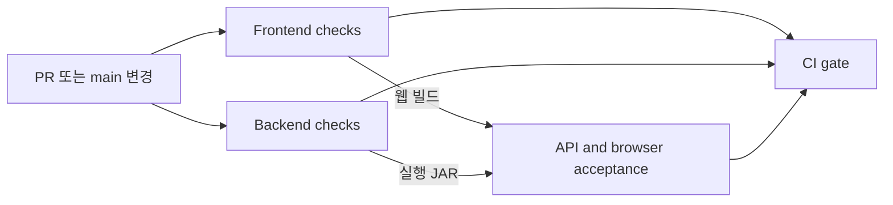

# arcat CI

> 기준일: 2026-10-14 · GitHub Actions / Ubuntu 24.04

2026-10-14의 main 커밋 `d8d1c016a03349c3d83ebfe83f15f598b6fba559`는 [실행 #38564943487](https://github.com/jujoycode/Arc/actions/runs/38564943487)에서 Frontend checks·Backend checks·API and browser acceptance·CI gate가 모두 성공했다. KRDS 공통 컨트롤·인증·업무 화면, 대화상자 초점 복원, 계층 간트와 마일스톤 1단계 API를 포함한 코드의 검사 결과다.

게이트는 선행 세 검사가 모두 `success`일 때만 성공한다. 그러나 현재 main에는 이 게이트를 필수로 요구하는 병합 보호가 등록되어 있지 않다. 아래 [병합 보호 점검](#병합-보호-점검)에 실제 저장소 설정과 적용할 설정안을 구분했다.

## 검사 구성

| 검사 | 실행하는 작업 | 잡아내는 문제 |
| --- | --- | --- |
| Frontend checks | Node 24, pnpm 11.19.0 고정 설치, lint, 기능 경계·TypeScript 검사, Vite 빌드 | 잠금 파일 불일치, 잘못된 의존·타입·경로, 빌드 실패 |
| Backend checks | Java 21, Gradle wrapper 검증, 패키지 경계, 트랜잭션 커밋·롤백·중복 키 검사, `check bootJar` | 모듈 경계 위반, 컴파일·검사·패키징 실패 |
| API and browser acceptance | 새 MySQL 8.4·Mailpit, 실행 JAR와 웹 번들, API·Chromium·axe 수용 검사 | 마이그레이션, 인증·권한·잠금, 화면 연결, 간트 출력·스프린트·키보드·접근성·반응형 회귀 |
| CI gate | 앞의 세 검사 결과 확인 | 실패하거나 건너뛴 필수 검사를 성공으로 처리하는 문제 |



프런트·백엔드 검사는 병렬로 실행한다. 수용 검사는 생성된 빌드 파일을 다운로드해 실행하며 다시 빌드하지 않는다. 프런트는 Vite preview로 정적 빌드 결과를 제공한다.

## 실행 조건과 유지 관리

- `main` 대상 PR, `main` push, Actions 화면의 수동 실행을 지원한다.
- 경로 필터를 두지 않아 문서만 바뀐 PR에도 완료된 검사 결과가 남는다.
- 같은 PR·브랜치에서 새 실행이 시작되면 이전 실행을 취소한다.
- 외부 Actions는 확인한 커밋 SHA로 고정한다. Dependabot이 매주 Actions 갱신 PR을 만든다.
- pnpm 설치 Action은 Node 24 런타임을 사용하는 `pnpm/action-setup` v6.1.0의 커밋으로 고정한다. 갱신한 코드 `af15117ac0f190466f841c82fa3196231867d978`의 [main 실행 #38567065603](https://github.com/jujoycode/Arc/actions/runs/38567065603)에서도 네 검사가 모두 성공했다.
- pnpm 버전은 `frontend/package.json`의 `packageManager`를 따르며 `--frozen-lockfile`로 설치한다.
- pnpm 저장소와 Gradle 캐시를 사용한다. Gradle 캐시 쓰기는 main으로 제한한다.
- Gradle 배포 파일 SHA-256을 wrapper 설정에 고정한다.
- 프런트 10분, 백엔드 15분, 수용 검사 20분의 실행 제한을 둔다.

## 데이터와 권한

DB와 메일함은 각 실행에서 생성하고 종료 후 제거하는 서비스 컨테이너다. 워크플로의 비밀번호는 임시 DB 전용 값이다. 운영 DB·SMTP·GitHub·GitLab 자격 증명은 필요하지 않다.

저장소 권한은 `contents: read`다. checkout은 인증 정보를 작업 디렉터리에 남기지 않는다. PR 코드는 `pull_request` 이벤트에서 검사한다.

API 검사는 팀 격리, 초대·역할·소유권, 동시 번호 발급, 낙관적 잠금, 관계 순환, 스프린트, 보관 정책을 확인한다. 브라우저 검사는 실제 생성·편집, 공통 필터, 간트 집계·저장 보기·PNG/PDF, 실패 복원·충돌 입력 보존, 멤버 권한, 모바일 키보드 조작을 확인한다.

Gradle check는 트랜잭션·제공자 계약·실제 날짜·티켓 필드 규칙·정책 저장·마일스톤 검증과 이력 롤백 테스트를 포함한다. 현재 코드의 테스트는 18개다. API·브라우저 검사도 함께 필수로 실행하며 lint의 기존 경고는 출력하되 실패로 처리하지 않는다. 위 main 실행의 lint 결과는 경고 11개·오류 0개였고, 큰 번들 청크 안내도 실패 기준은 아니다.

`scripts/milestone-smoke.py`는 생성·목록·상세·수정·취소·재개·이력의 일곱 API, 필드와 날짜 검증, revision 충돌, 프로젝트별 관리자·일반 멤버 권한, 다른 팀·프로젝트 격리, 담당자 이탈, 버전 연결·값 해제, 보관 정책, 페이지 처리와 동시 수정 경쟁을 검사한다. 기존 티켓·버전이 보존되는지도 확인한다. [마일스톤 API](MILESTONE_API.md)의 1단계 구현 범위를 대상으로 한다.

기본 브라우저 검사는 `scripts/krds-render-checks.mjs`를 함께 실행한다. 공통 폼 치수, 실제 대화상자 닫기 후 원래 버튼으로 돌아가는 초점, 짧은 화면에서 입력과 초점 표시가 가려지지 않는지, 키보드 테이블 스크롤, 간트의 실제 행·바 좌표와 계층 접기 복원 등을 검사한다.

`scripts/ticket-fields-smoke.py`는 OWNER/ADMIN과 프로젝트 관리자 구분, 워크스페이스 격리, 필수값·타입·비활성/숨김 값 보존·기존 요청 호환·필드 revision과 티켓 version 충돌을 확인한다. `scripts/ticket-fields-browser.mjs`는 실제 설정·티켓 양식, 필드 오류와 초안 보존, 잘못된 응답 차단, 스프린트 대화상자 실패, 개발자 실행 권한을 검사한다. 기본 브라우저 검사에는 arcat 로고·favicon·캐릭터 로딩과 모션 감소 설정도 포함한다.

`scripts/calico-brand-browser.mjs`도 빌드 결과를 대상으로 하는 필수 수용 검사다. 로그인·가입·인증 오류·워크스페이스/프로젝트 빈 상태·WBS/스프린트 빈 상태·프로젝트 칸반의 8개 상태를 1920/768/360px에서 검사해 axe 규칙 24개와 문서 가로 넘침을 확인한다. 삼색 이미지·favicon·상단 로고, 제한된 몸·눈 움직임, 비밀번호 초점의 눈 가림과 값 변화에 따른 위치 불변, 초점 해제·창 이탈·모션 설정 변경·SPA 이동 후 복원 및 정리, 터치 정지, 서로 다른 배정·저장 자세를 확인한다. WBS/스프린트 조회 중·오류와 WBS 필터 결과만 비어 있을 때 실제 빈 업무 안내를 표시하지 않는지도 검사한다. 자기 워크스페이스를 만들고 끝에 삭제하며, 외부 자격 증명은 필요하지 않다.

이 자동 검사 결과는 실기기 화면 읽기 도구 검증이나 공식 접근성 인증을 대체하지 않는다.

## 병합 보호 점검

2026-10-14에 GitHub API로 확인한 main의 `protected`는 `false`, `protection.enabled`는 `false`, 필수 검사 목록은 비어 있었다. 상위 규칙을 포함한 저장소 ruleset 조회도 `[]`였다. 따라서 워크플로에 `CI gate`가 있어도 실패한 PR의 병합을 막는 저장소 규칙은 아직 없다.

실제로 [PR #2](https://github.com/jujoycode/Arc/pull/2)는 [PR 실행 #38498873093](https://github.com/jujoycode/Arc/actions/runs/38498873093)의 API and browser acceptance·CI gate가 실패한 상태에서 병합되었다. 이후 main 실행은 성공했다. 이는 워크플로 게이트와 GitHub 병합 보호를 각각 설정해야 하는 이유다. 게이트의 현재 비교식을 성공·실패·취소·건너뜀의 64가지 조합으로 확인했으며, 세 검사가 모두 성공한 한 경우만 통과했다.

현재 연결에서 상세 branch-protection 관리 API는 `403 Resource not accessible by integration`을 반환한다. 이 연결로 병합 보호를 설정했다고 간주할 수 없다. 저장소 관리 권한으로 GitHub **Settings → Branches → Add branch protection rule**에서 `main`을 대상으로 다음 설정을 적용한다.

- **Require status checks to pass before merging**에 GitHub Actions의 `CI gate`를 필수 검사로 선택한다.
- **Require branches to be up to date before merging**을 켠다.
- 관리자도 검사를 거치도록 **Do not allow bypassing the above settings**를 켠다.

관리 API로 적용할 때 검토할 요청 본문은 [main 병합 보호 설정안](ci/main-branch-protection.json)에 있다. 아직 적용된 설정은 아니다. 적용 후 main 변경은 PR에서 필수 검사를 통과시켜 병합하는 흐름으로 진행한다. 경로 필터가 있는 Compose 검사는 이 필수 검사에 포함하지 않는다.

## 결과와 실패 조사

[arcat Actions](https://github.com/jujoycode/Arc/actions/workflows/ci.yml)에서 단계별 로그를 확인한다. 빌드와 검증 자료는 7일 동안 보관한다.

- `frontend-build`: 검증에 사용한 웹 번들
- `backend-build`: 검증에 사용한 실행 JAR
- `acceptance-artifacts`: 서버·프런트·API·브라우저 로그, 간트 PNG/PDF 출력
- 브라우저 실패 시 `acceptance-artifacts/browser/failure.png`와 `trace.zip`
- 삼색 브랜드 검사 자료는 `acceptance-artifacts/browser/calico-brand/verification.json`, 화면별 axe JSON·PNG와 `trace.zip`
- Gradle 실패 시 보고서가 생성되었다면 `backend-diagnostics`

추적 파일을 다운로드한 뒤 요청·화면·조작 순서를 확인한다.

```bash
cd frontend
pnpm exec playwright show-trace /path/to/trace.zip
```

## 로컬 재현

Java 21, Node 24, pnpm, Python 3, curl, Linux의 `setsid`가 필요하다. [README](../README.md)의 MySQL·Mailpit을 준비하고 8080·5173 포트의 다른 앱 실행을 종료한다.

```bash
pnpm --dir frontend install --frozen-lockfile
pnpm --dir frontend lint
pnpm --dir frontend build
(cd backend && ./gradlew --no-daemon check bootJar)
pnpm --dir frontend exec playwright install --with-deps chromium
set -a
source .env
set +a
bash scripts/ci/acceptance.sh backend/build/libs/arc-backend-0.0.1-SNAPSHOT.jar
```

스크립트는 `.ci-artifacts/`에 자료를 남기고 자신이 시작한 API·웹 프로세스를 정리한다. 이미 사용 중인 포트는 거부한다. 다른 포트는 `ARC_CI_API_PORT`, `ARC_CI_WEB_PORT`, `DB_URL`, `SMTP_PORT`, `ARC_MAIL_URL`로 지정한다. `CHROMIUM_PATH=''`는 설치한 Playwright Chromium을 사용하며, 특정 시스템 브라우저 경로도 지정할 수 있다.

## 추가하면 좋은 검사

1. **병합 보호:** 위 설정안을 저장소 관리 권한으로 적용하고, 실패한 검사로 병합할 수 없는지 확인한다.
2. **보안 검사:** CodeQL과 의존성 취약점 검사를 별도 워크플로로 추가한다. 대응 기준을 정한 뒤 실패 기준을 조정한다.
3. **단위·DB 테스트:** 날짜 집계와 계층 규칙, 트랜잭션·잠금처럼 변경 위험이 큰 부분부터 추가한다.
4. **대량 데이터:** 간트·보드·백로그 응답 시간과 브라우저 표시 비용을 측정한다. PR 기능 검사와 분리한 수동·정기 실행이 적합하다.
5. **접근성과 배포:** 현재 자동 검사에 더해 실기기·화면 읽기 도구로 핵심 흐름을 검증한다. 운영 대상이 확정되면 환경별 배포·상태 확인을 연결한다.

## Compose 설치 검증

`deployment-check.yml`은 Dockerfile·nginx·Compose·설치 스크립트를 바꾸는 PR 또는 수동 실행에서 이미지를 직접 빌드합니다. 새 MySQL·Mailpit와 웹·API를 띄워 nginx 경유 API·브라우저 수용 흐름을 검사하고, DB 백업을 별도 DB에 복원해 사용자·이슈·Flyway 기록 수를 비교합니다. 테스트 설치는 종료 시 볼륨과 함께 제거합니다. 실제 서버에 배포하거나 이미지를 레지스트리에 게시하지 않습니다. 기존 `CI gate`는 프런트·백엔드·수용 검사를 계속 요구합니다.

```bash
gh workflow run deployment-check.yml --repo jujoycode/Arc
```

Compose 검사도 checkout의 `persist-credentials: false`를 사용해 읽기 토큰을 Git 설정에 남기지 않습니다. 환경 파일과 백업은 runner의 임시 디렉터리에만 두며 설치 로그·브라우저 실패 자료만 7일간 보관합니다.

Compose 설치 검증은 [GitHub 실행](https://github.com/jujoycode/Arc/actions/runs/37477976978)에서 이미지 빌드·전체 API/브라우저·백업 복원을 통과했습니다. 기본 수용 검사는 로컬 제공자 모형을 함께 띄워 GitHub·GitLab 인증 계약·서명·큐·중복·이슈 범위·권한 상실도 검사합니다. 모형의 키와 토큰은 테스트 전용이며 외부 제공자에 요청하지 않습니다.
