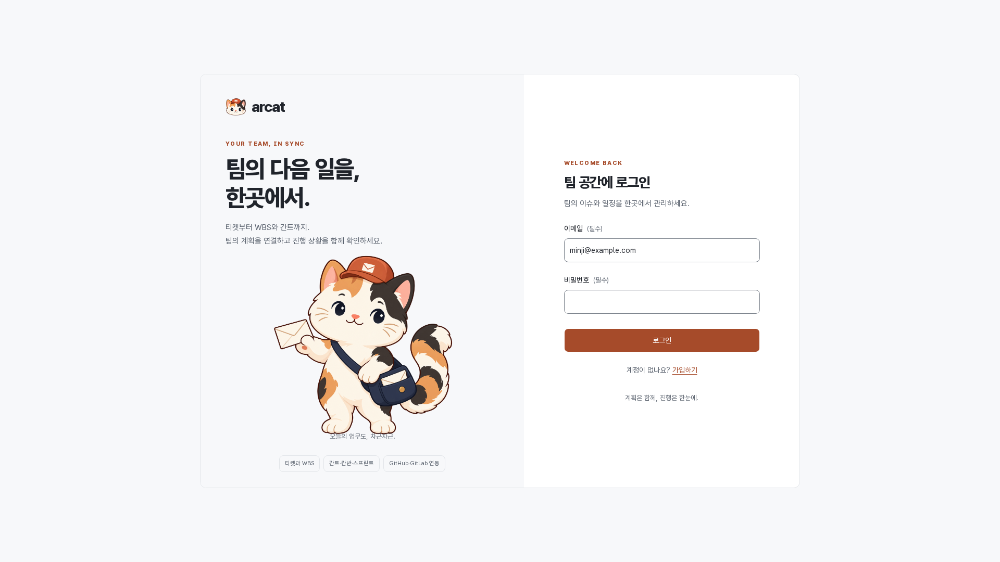
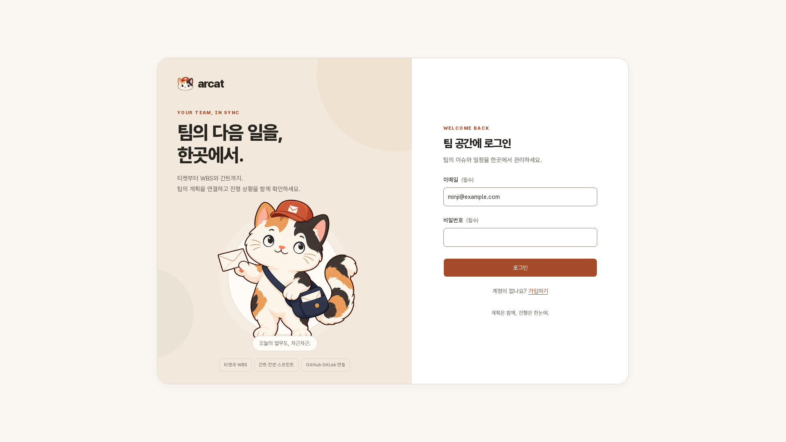
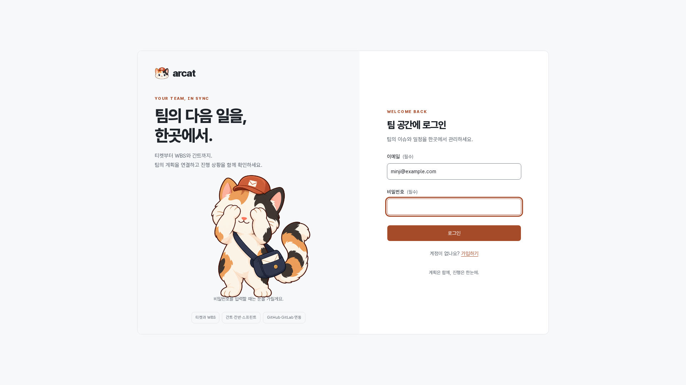
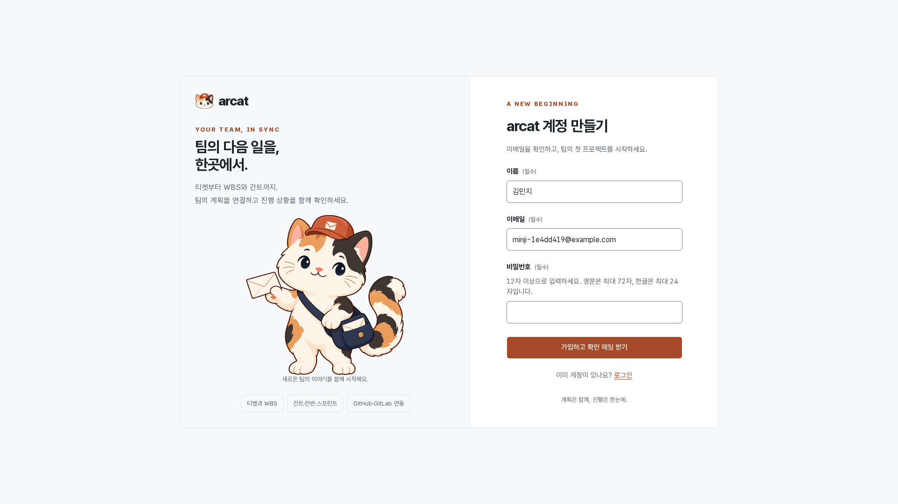
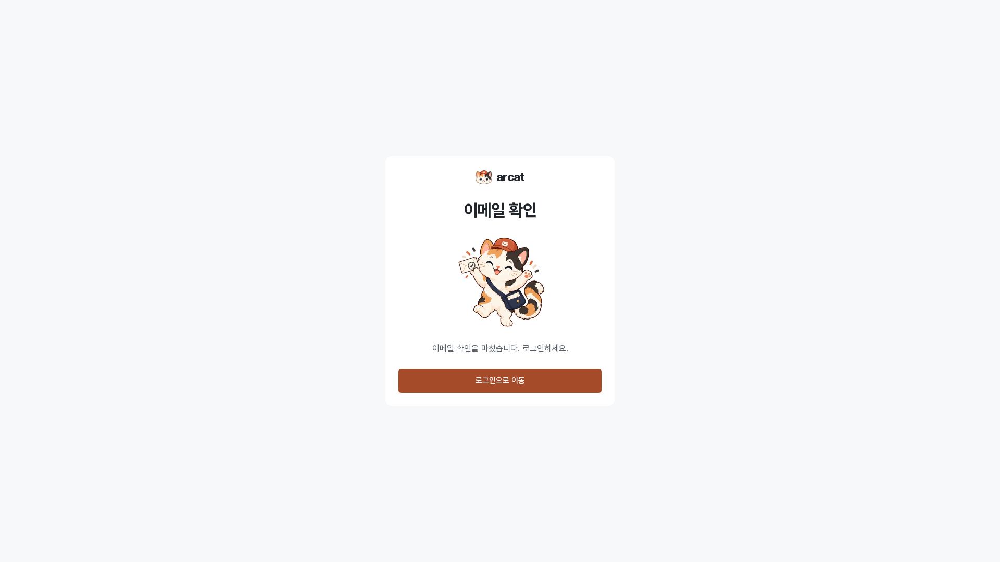
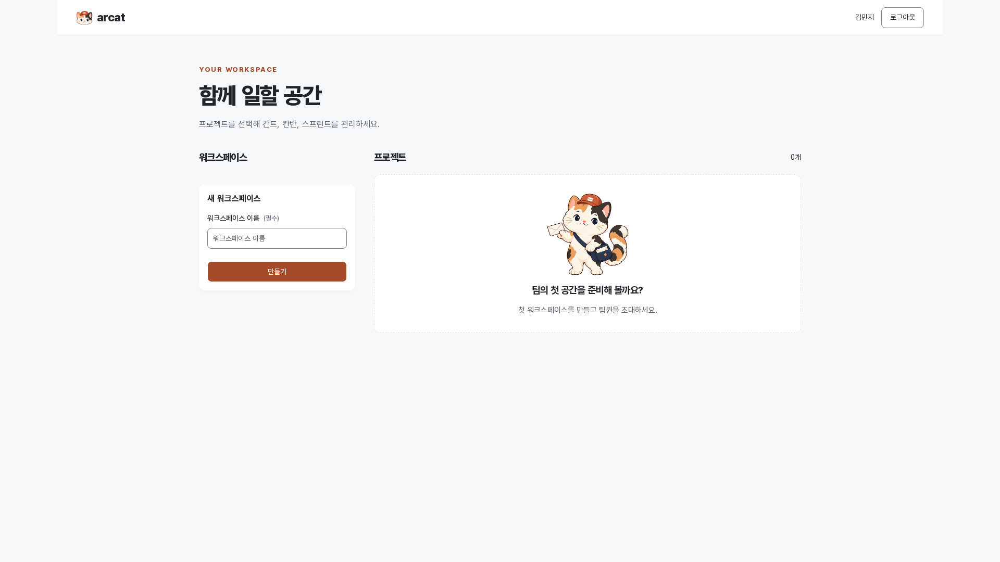
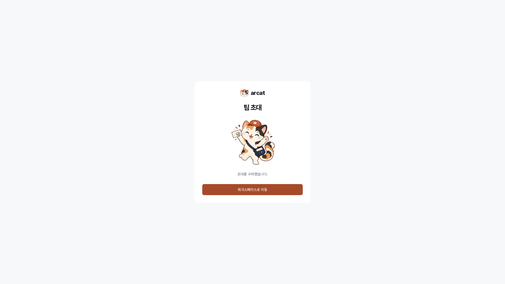
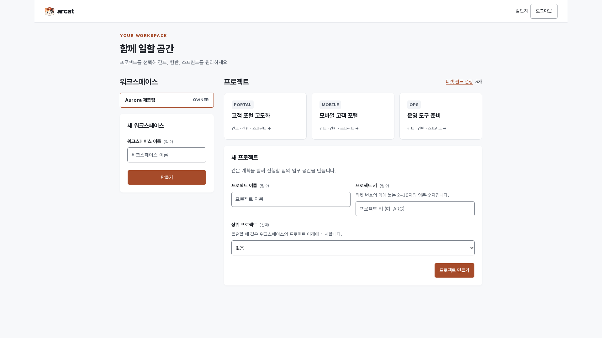
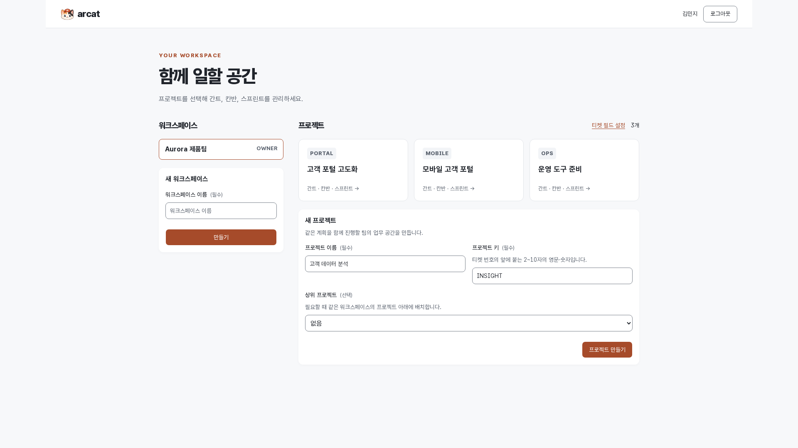

# 팀 공간 시작하기

[제품 소개](README.md) · [전체 기능 안내](FEATURES.md)

삼색 집배원 고양이가 안내하는 로그인·가입 화면에서 시작합니다. 마우스를 따라 바라보고 비밀번호 입력 중 눈을 가리는 두 모습도 확인할 수 있습니다. 이메일 확인을 거쳐 첫 워크스페이스를 준비하거나 팀 초대를 수락하고, 함께 일할 프로젝트를 선택합니다.

> 2026-10-11 · Asia/Seoul · 실제 앱 촬영 · 모든 원본 1920×1080

사진을 누르면 원본을 볼 수 있습니다. 동일한 데모 팀의 업무 흐름을 순서대로 촬영했으며 스프린트 종료·보관 전후에는 상태가 달라집니다.

마우스 반응 사진 두 장은 정밀 포인터와 일반 모션 설정에서 실제 앱을 촬영했습니다. 비밀번호 입력은 비워 두었으며, 고양이는 입력값을 읽지 않고 포커스 상태에만 반응합니다. 나머지 화면은 움직임 감소 모드의 정지 장면입니다.

## 이메일 로그인

삼색 집배원 고양이가 안내하는 시작 화면에서 검증된 이메일로 팀 공간에 접속합니다.

**사용자:** 모든 사용자 · **화면:** `/login` · 화면 상단

이 기능에서 할 수 있는 일:

- 삼색 고양이와 크림·테라코타·차콜 제품 색상
- 이메일·비밀번호 로그인
- 가입 화면 이동

## 마우스를 따라 바라보는 삼색 고양이

로그인 화면에서 고양이의 눈과 몸이 마우스 방향을 작게 따라 움직입니다.

**사용자:** 마우스를 사용하는 사용자 · **화면:** `/login` · 화면 상단

이 기능에서 할 수 있는 일:

- 정밀 포인터에서 눈동자·몸의 제한된 움직임
- 상시 반복 없이 포인터 움직임에 반응
- 터치·움직임 감소 환경에서는 정지 상태
- 업무 입력을 방해하지 않는 장식

## 비밀번호 입력 중 눈을 가리는 고양이

비밀번호 입력에 포커스하면 고양이가 앞발로 눈을 가리고 마우스 추적을 멈춥니다.

**사용자:** 로그인·가입 사용자 · **화면:** `/login` · 화면 상단

이 기능에서 할 수 있는 일:

- 비밀번호 값 대신 포커스 상태에만 반응
- 포커스가 빠지면 원래 안내로 복귀
- 빈 비밀번호 입력으로 촬영
- 마스코트 장식과 함께 일반 비밀번호 입력 유지

## 계정 가입

이름과 이메일로 계정을 만들고 확인 메일을 받습니다.

**사용자:** 모든 사용자 · **화면:** `/register` · 화면 상단

이 기능에서 할 수 있는 일:

- 삼색 집배원 고양이와 팀 시작 안내
- 이름·이메일·비밀번호 입력
- 12자 이상 비밀번호
- 이메일 확인 후 로그인

## 이메일 확인 완료

실제 확인 메일의 일회용 링크로 이메일을 검증합니다.

**사용자:** 가입 사용자 · **화면:** `/verify` · 화면 상단

이 기능에서 할 수 있는 일:

- 확인 링크 검증
- 고양이와 텍스트로 확인 결과 안내
- 로그인으로 이동

## 첫 워크스페이스 시작 안내

삼색 집배원 고양이와 안내를 따라 첫 팀 공간을 준비합니다.

**사용자:** 새로 가입한 사용자 · **화면:** `/` · 화면 상단

이 기능에서 할 수 있는 일:

- 업무가 없는 가입 직후의 실제 빈 상태
- 워크스페이스 이름 입력과 생성
- 첫 공간 생성 후 프로젝트 준비
- 장식 캐릭터와 텍스트 안내

## 팀 초대 수락

초대받은 이메일로 로그인한 뒤 팀에 합류합니다.

**사용자:** 초대받은 팀원 · **화면:** `/invite` · 화면 상단

이 기능에서 할 수 있는 일:

- 초대 이메일 일치 확인
- 고양이와 텍스트로 초대 수락 안내
- 워크스페이스로 이동

## 워크스페이스와 프로젝트 선택

팀 공간과 프로젝트를 선택하고 프로젝트 간 이동을 시작합니다.

**사용자:** 팀원·관리자 · **화면:** `/` · 화면 상단

이 기능에서 할 수 있는 일:

- 워크스페이스별 역할
- 프로젝트 카드
- 상위 프로젝트 지정
- 새 워크스페이스·프로젝트 생성

## 새 프로젝트 준비

프로젝트 이름·키·상위 프로젝트를 정해 관리 범위를 나눕니다.

**사용자:** 워크스페이스 소유자·관리자 · **화면:** `/` · 화면 상단

이 기능에서 할 수 있는 일:

- 프로젝트 키 입력
- 상위 프로젝트 선택
- 관리자 생성 권한
